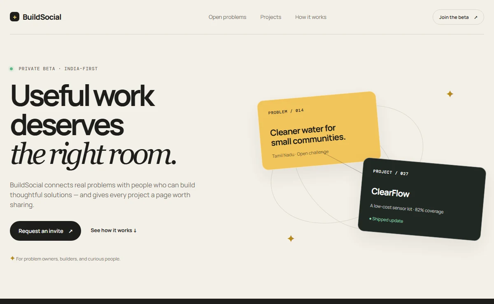

# BuildSocial

A problem owner sets out what a solution needs to do. A builder shows which requirements their project meets, what still needs work, and what changed in the latest update. BuildSocial lets you explore both sides of that exchange with sample projects from across Tamil Nadu and beyond.



## Follow one problem

From the repository root, start the prototype with Python 3.

```sh
python -m http.server 4173 --bind 127.0.0.1
```

1. Open the [homepage](http://localhost:4173/index.html) and choose **Open problems**. On [Explore](http://localhost:4173/explore.html), search for “water”.
2. Open the [clean-water challenge](http://localhost:4173/problem.html?slug=clean-water-testing). The collective needs an affordable test kit that volunteers can use offline. Read the four requirements before following the linked project.
3. Visit [ClearFlow](http://localhost:4173/project.html?slug=clearflow). Compare the sensor kit’s capabilities with its calibration limits, open the update history, then save the project and reload the page.
4. Open the [workspace](http://localhost:4173/prototype.html) to try drafting a problem as an owner or describing a project as a builder.

## Inside the prototype

| Area | Where to look |
| --- | --- |
| Public catalog | [Public fixtures](app.js) supply the problems, requirements, projects, and updates. [Explore](explore.js) handles search and filtering. |
| Workspace | [Workspace fixtures](fixtures.js) and [interaction code](prototype.js) drive role views and local drafts. |
| Design | [Base styles](styles.css), [Explore styles](explore.css), and [detail layouts](detail.css) define the warm paper, ink, gold and mint palette. |
| Planned product | The [specification](docs/01_PRODUCT_SPEC.md) and [project status](docs/STATUS.md) distinguish the proposed platform from this clickable prototype. |

The pages run as static HTML, CSS and JavaScript. Saves and drafts use browser storage. Sample coverage, publishing, notifications and profiles illustrate the intended experience. Accounts, GitHub authorization, moderation, uploads, and shared database storage belong to the proposed platform. The invite form shows a local acknowledgement.

<details>
<summary>Check the JavaScript files</summary>

```sh
node --check app.js
node --check explore.js
node --check fixtures.js
node --check prototype.js
```

</details>
